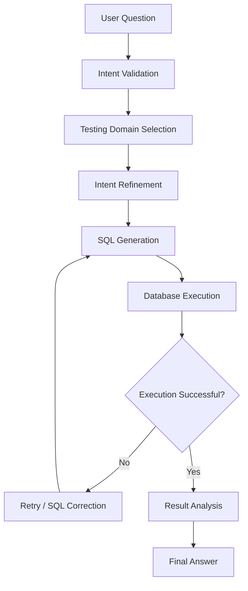

# Architecture

## High-Level Workflow

## Components

### Orchestrator
Coordinates the application's workflow and domain-level processing.

### Intent Validation and Refinement
Checks whether a question is supported and converts it into a more focused intent.

### SQL Generation
Uses LLM prompts and schema context to generate SQL for the requested analytics task.

### Database Executor
Executes generated queries and provides a retry/self-healing path for failures.

### Result Analysis
Interprets retrieved data to prepare a response relevant to the original question.

## Limitations

This diagram represents the intended high-level processing flow. Actual
runtime behavior and security controls should be validated against the
published implementation.